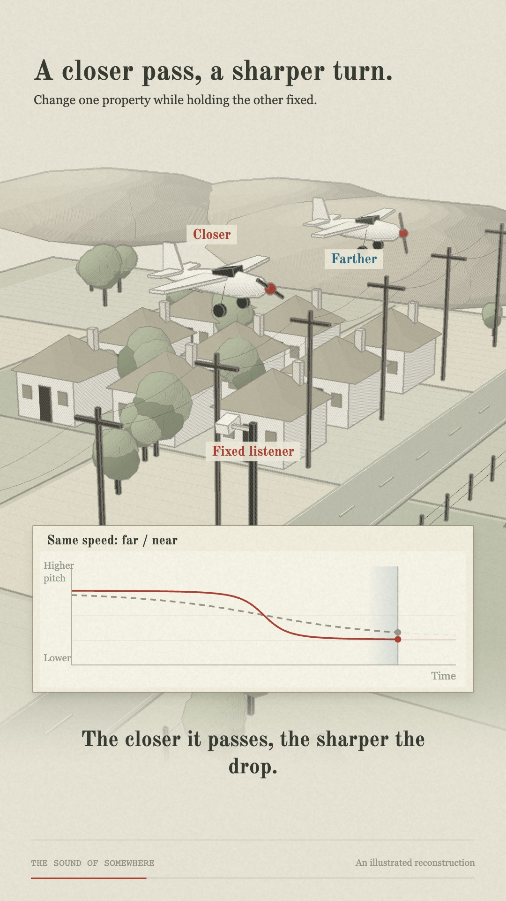

# Codex 6 Astra Low — The sound of somewhere

An animation experiment using Three.js, original procedural scenes, and the soundtrack of this Instagram reel:

**https://www.instagram.com/reel/DfSsHlYtpNc/**

## Watch

- [Interactive animation](https://andrew-chen-wang.github.io/threejs-animation-experimentation/codex-6-astra-low/)
- [Rendered finale player](https://andrew-chen-wang.github.io/threejs-animation-experimentation/codex-6-astra-low/watch.html)
- [720p MP4 in this folder](renders/finale-720p.mp4)
- [Exact full-quality 1080p finale](https://github.com/Andrew-Chen-Wang/threejs-animation-experimentation/releases/download/codex-6-astra-low-v4/The-sound-of-somewhere-v4.mp4)
- [Opus animation](https://andrew-chen-wang.github.io/threejs-animation-experimentation/)



The final film runs 2:59 at 30 fps. The full-quality file exceeds GitHub's 100 MiB Git file limit, so it is attached to the release; the smaller encode is committed here. Both retain the original audio. Original narration credits the investigation to ColstO.

## Assessment

**It seemed like Opus 5.5 did a better job overall.** This is the project owner's qualitative assessment, not a controlled benchmark. Codex required several rounds of correction: the first pass illustrated the subject without sufficiently explaining it; the clearer version became too static; the motion pass lost too much of the original 3D pencil-drawn character. The final revision tries to retain all three: explanation, sustained motion, and the requested style.

**The original script is pretty bad at explaining a crucial step:** where the aircraft locations come from. A more complete explanation would say that aircraft broadcast position information through systems such as ADS-B, receiver networks collect time-stamped observations, and historical flight-track data for the relevant date supplies known aircraft positions. You then predict what those flights would sound like at possible microphone locations and compare those predictions with the video's audio. The audio does not directly contain a GPS coordinate. Nor does this mean a complete, unrestricted archive of every aircraft is available: coverage, aircraft participation, historical access and provider terms vary. See the [OpenSky API documentation](https://openskynetwork.github.io/opensky-api/) for an example of aircraft-state data and its access limitations.

## Learnings

1. Storyboard each spoken claim as a visible cause, change, and consequence.
2. Show why a location fails before rejecting it. Consistent candidate labels and recorded/predicted colors make the argument followable.
3. Give each shot a continuing action. Revealing a slide or a highlight does not keep the scene moving through the narration.
4. Keep axes and labels stable while trajectories, waves, traces and camera views move.
5. Preserve visual identity while improving clarity. The 3D pencil style was part of the brief throughout.
6. Review consecutive frames and full timed passages. Attractive stills miss motion problems; pixel-change checks do not prove attention or comprehension.
7. Keep simulations honest. Candidate positions, flight tracks, spectrograms and matching results here are illustrations, not a reproduced localization investigation.

Detailed notes: [animation findings](docs/animation-findings.md) and [storyboard / research](docs/explanation-design.md).

## Run and build

```sh
cd codex-6-astra-low
npm ci
npm run dev:film
npm run test:film
npm run check:film
npm run build:film
```

The browser needs WebGL2. Space plays/pauses, arrow keys seek, and the desktop chapter menu jumps between explanations. The rendered-video player is available for devices where live rendering is slow.

`npm run render:film` uses ffmpeg and Playwright Chromium to export the complete film. Install the browser with `npx playwright install chromium` first. The export script uses Vite's development entry `film.html`; the Pages build also exposes it as `index.html` in this folder.

## Implementation and credits

- `src/film/pencil.ts`: surface hatching, graphite contours, procedural rural world, raised map, waves and cameras.
- `src/film/pencil-composition.ts`: scene staging and compact explanatory graph insets.
- `src/film/physics.ts`: illustrative point-source acoustic model.
- `src/film/main.ts`: timing, captions and playback.
- Fonts: Old Standard TT and Oswald, SIL Open Font License; license files are in `public/fonts/`.
- Geography: Natural Earth, public domain.
- Reference video/audio: the linked Instagram reel; the new animation does not reuse its frames.

Validation included TypeScript, a production build, acoustic-model checks, sampled visual review, deterministic seeking, and full MP4 decoding. The full-quality audio stream matched the extracted source exactly. User feedback established that the explanatory direction improved; it is not a formal audience study or approval of every detail.
